[English](./README.md) · [Website](https://negplan.lei6393.com) · [GitHub](https://github.com/SuperMarioYL/negplan)

<picture>
  <source media="(max-width: 600px) and (prefers-color-scheme: dark)" srcset="./assets/presentation/hero-mobile-dark.svg">
  <source media="(max-width: 600px)" srcset="./assets/presentation/hero-mobile-light.svg">
  <source media="(prefers-color-scheme: dark)" srcset="./assets/presentation/hero-dark.svg">
  
</picture>

# negplan

**把明确不做的工作写下来。**

negplan 为编码任务提供可携带的 Markdown 台账，记录计划实施、明确排除的工作及原因。当前 CLI 可以创建并校验这份文档。

## 为什么需要它

排除项与需求并列、带有 ID 和原因时，更容易讨论。把约定保存在文件中，人或能读取 Markdown 的 Agent 都可使用。

- **明确排除项** — 每个排除项保留原因。
- **保存可携带文件** — Markdown 可随项目保存。
- **检查结构** — 校验器报告违反 schema 的字段。

## 架构

<picture>
  <source media="(max-width: 600px) and (prefers-color-scheme: dark)" srcset="./assets/presentation/architecture-mobile-dark.svg">
  <source media="(max-width: 600px)" srcset="./assets/presentation/architecture-mobile-light.svg">
  <source media="(prefers-color-scheme: dark)" srcset="./assets/presentation/architecture-dark.svg">
  
</picture>

init 展开 Markdown 模板；解析器将 YAML frontmatter 与三个表格章节读成类型化台账，专用校验器检查随仓 schema，serializeLedger 写出规范格式。gate 从 stdin 读取 unified diff，将每个 hunk 映射到其头部引用的 will_implement 条目，并把 allowed/creep 判定写入 gates 表；render 仍是里程碑占位。

| 组件 | 职责 |
| --- | --- |
| `Markdown template` | templates/ledger.template.md |
| `Ledger parser` | src/ledger.ts |
| `Schema validation` | schemas/ledger.schema.json |
| `Canonical serialization` | serializeLedger |
| `Diff gate` | src/gate.ts |

## 安装与快速上手

使用仓库清单声明的运行时版本。以下源码安装步骤可复现随仓示例。

```bash
git clone https://github.com/SuperMarioYL/negplan.git
cd negplan
npm ci
npm run build
```

需要 Node.js 22+；解析完整台账示例，完成序列化往返，并拒绝无效生命周期状态。

```bash
node examples/presentation-demo.mjs
```

## 实际运行示例

<picture>
  <source media="(max-width: 600px) and (prefers-color-scheme: dark)" srcset="./assets/presentation/process-mobile-dark.svg">
  <source media="(max-width: 600px)" srcset="./assets/presentation/process-mobile-light.svg">
  <source media="(prefers-color-scheme: dark)" srcset="./assets/presentation/process-dark.svg">
  
</picture>

The example has two allowed and three excluded items; its round trip validates, while status=unexpected fails.

```text
{
  "task": "Build the login page",
  "will_implement": 2,
  "will_not_implement": 3,
  "validation": {
    "valid": true,
    "errors": []
  }
}
roundtrip valid: true
{
  "valid": false,
  "errors": [
    ".status: must be one of drafting, negotiating, gating, done"
  ]
}
```

完整命令与输出保存在 [docs/demo-results.json](./docs/demo-results.json). 输入和复现代码均随仓提供。


保留已有录制供参考；上方文字示例给出当前可复现的操作。

## 用法

安装后在仓库根目录运行以下命令；处理自己的数据时替换相应路径。

```bash
node dist/src/cli.js init --task "Add CSV export" --output .negplan.md
# Fill the allowed/excluded entries in .negplan.md, then:
node dist/src/cli.js validate --file .negplan.md
node dist/src/cli.js validate --file examples/example-ledger.md
# Gate a proposed diff: cite the will_implement entry after the @@ header
printf '+++ b/src/export.ts\n@@ -1,1 +1,2 @@ satisfies w1\n+exportCsv()' | node dist/src/cli.js gate .negplan.md
```

`gate` 在所有 hunk 都引用了 will_implement 条目时返回 0，有 hunk 被判为 creep 时返回 1，用法或台账错误返回 2。每个 hunk 输出一行判定，并追加到台账的 gates 表。

## 配置

台账开头包含 task、可选 agent/created_at 与 status（drafting、negotiating、gating 或 done）。will_implement 行含 id、summary、rationale；will_not_implement 还包含 overridden。gates 定义 change_id、file、hunk、entry_id、verdict、human_override，供后续门禁记录使用。init --force 会覆盖已有文件；不加时保留现有约定。

## 集成与职责分工

<picture>
  <source media="(max-width: 600px) and (prefers-color-scheme: dark)" srcset="./assets/presentation/integrations-mobile-dark.svg">
  <source media="(max-width: 600px)" srcset="./assets/presentation/integrations-mobile-light.svg">
  <source media="(prefers-color-scheme: dark)" srcset="./assets/presentation/integrations-dark.svg">
  
</picture>

根据工作流选择输入与输出路径。本文本地示例验证其中明确说明的子流程。

| 路径 | 已实现职责 |
| --- | --- |
| Markdown + YAML | Task and scope decisions |
| init CLI | Create a starting document |
| validate CLI | Document-shape check |
| TypeScript functions | Parse and serialize ledgers |
| Agent-readable file | Manual scope agreement |

## 限制与后续方向

- 门禁按 hunk 头部引用的 will_implement 条目匹配，不理解 diff 语义，格式正确但引用错误的判定仍会通过。交互式否决/覆盖界面（`render`）尚未实现；该命令打印路线图文字并可能返回零。
- 校验检查文档结构，不判断计划是否合理，也不验证生成代码是否遵守约定。
- 表格解析器只支持特定格式，不是完整 Markdown 实现；条目应沿用提供的表格格式。

v0.2.0 实现了 m2（diff 到台账的约束）。m3（否决/允许摘要与覆盖界面）下一步实现；当前版本提供台账契约与门禁。

## 许可与贡献

许可见 [LICENSE](./LICENSE). 反馈问题时请提供最小输入、执行命令和实际输出。
