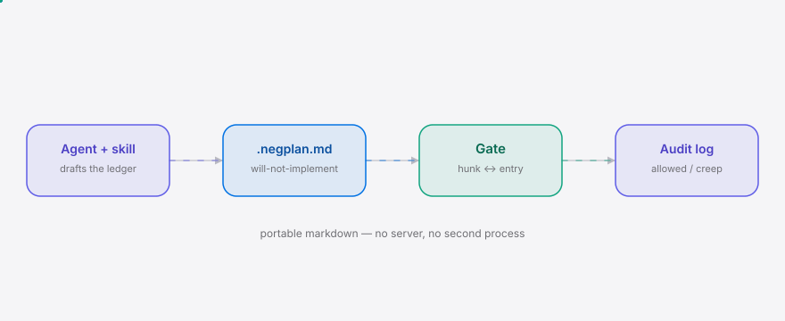

<div align="right"><sub><a href="./README.md">EN</a>&nbsp;&nbsp;⇄&nbsp;&nbsp;<b>中文</b></sub></div>

<picture>
  <source media="(prefers-color-scheme: dark)" srcset="./assets/hero-dark.svg">
  <source media="(prefers-color-scheme: light)" srcset="./assets/hero-light.svg">
  
</picture>

<p align="center"><sub>NegPlan 是一份「不予实现」清单，为独立开发者守住编码 agent 的范围蔓延。</sub></p>

<p align="center">
  <a href="./LICENSE"></a>
  <a href="https://github.com/SuperMarioYL/negplan/releases"></a>
  <a href="https://github.com/SuperMarioYL/negplan/actions/workflows/ci.yml"></a>
  
</p>

**别再手动删 agent 写的那堆投机代码了——让它先声明一份「不予实现」清单，再让每一行改动都通过一道你能覆盖的关卡。**

<h2> 架构</h2>

<picture>
  <source media="(prefers-color-scheme: dark)" srcset="./assets/atlas-dark.svg">
  <source media="(prefers-color-scheme: light)" srcset="./assets/atlas-light.svg">
  
</picture>

计划以一份**「不予实现」清单**（`.negplan.md`）开场。在写任何代码之前，agent 先把两份清单都填好——它会做什么、以及它拒绝做什么。之后每一段 diff 都必须引用一条 `will_implement` 条目；没有对应条目的改动会被当作范围蔓延拦在关卡前，直到你手动放行。两个组件、一个进程、没有服务端：一个可移植的 [Claude Code 技能](./SKILL.md)，加上一个读写同一份 markdown 文件的微型 Node CLI。

## 目录

- [为什么需要它](#为什么需要它)
- [快速开始](#快速开始)
- [用法](#用法)
- [演示](#演示)
- [路线图](#路线图)
- [许可证](#许可证)

<h2> 为什么需要它</h2>

编码 agent 默认会最大化范围：你让它做功能 X，它交付 X 加上投机的基础设施、顺手的重构、以及「既然都到这了」的额外特性——而如今的代码还能编译通过，所以事后删起来很费劲。NegPlan 把范围之争**挪到代码生成之前**：计划以一份机器可校验的「不予实现」清单开场，每一段 diff 都必须引用一条它满足的条目，否则就被拦在关卡前。清单是纯 markdown，所以它能跨 agent 存活——而不是把你锁死在某个平台 API 里。

<h2> 快速开始</h2>

从冷克隆到一份通过校验的清单，只需三条命令：

```bash
git clone https://github.com/SuperMarioYL/negplan.git && cd negplan && npm install && npm run build
node dist/src/cli.js init --task "Add a login page"   # 写入 .negplan.md（「不予实现」清单）
node dist/src/cli.js validate                          # → "negplan: .negplan.md is valid."
```

发布到 npm 后，第一行就变成 `npx negplan init --task "Add a login page"`。

<details><summary>示例输出</summary>

```
$ node dist/src/cli.js init --task "Add a login page"
negplan: wrote .negplan.md (task: "Add a login page")
next: open it, then ask your agent to fill the will_implement + will_not_implement lists.

$ cat .negplan.md
---
task: "Add a login page"
agent: claude-code
created_at: "2026-08-28T10:00:00Z"
status: drafting
---

## will_implement
| id | summary | rationale |
| --- | --- | --- |

## will_not_implement
| id | summary | rationale | overridden |
| --- | --- | --- | --- |

## gates
| change_id | file | hunk | entry_id | verdict | human_override |
| --- | --- | --- | --- | --- | --- |

$ node dist/src/cli.js validate
negplan: .negplan.md is valid.
```
</details>

然后告诉你的 agent：*"用 negplan 做功能 X。"* [技能](./SKILL.md)会让它把两份清单都填好，把否决项摆出来等你逐条 y/n 覆盖，之后再提出每一段都引用了条目的 diff。

<h2> 用法</h2>

```bash
negplan init    [--task "<文本>"] [--output <路径>] [--force] [--agent <名称>]   # 写入一份新清单
negplan validate [--file <路径>]                                                 # 按清单 schema 校验
negplan gate    [<文件>]        #（m2）按允许的条目逐段关卡校验 diff
negplan render  [<文件>]        #（m3）打印否决/放行摘要 + 覆盖面板
```

为一个真实任务起草清单：

```bash
negplan init --task "Add a login page" --output .negplan.md
```

校验一份手写或由 agent 填好的清单（失败时以非零码退出）：

```bash
negplan validate -f examples/example-ledger.md
```

一份已填充、schema 合法的清单示例：[`examples/example-ledger.md`](./examples/example-ledger.md)。`validate` 背后的 schema 在 [`schemas/ledger.schema.json`](./schemas/ledger.schema.json)，`init` 写出空白清单所用的模板在 [`templates/ledger.template.md`](./templates/ledger.template.md)。

<h2> 演示</h2>

m1 的最小路径——`init` 写出一份新的「不予实现」清单，随后 `validate` 变绿：


<h2> 路线图</h2>

- [x] **m1 — 定义清单。** `negplan init` + `negplan validate`、[`ledger.schema.json`](./schemas/ledger.schema.json)，以及在任何构建请求上起草清单的 [Claude Code 技能](./SKILL.md)。
- [ ] **m2 — 执行关卡。** `negplan gate` 按文件/id 把每段 diff 映射到一条 `will_implement` 条目，给出 `allowed` / `creep` 裁决，并追加到清单的 `gates` 审计日志。未匹配的改动以一句理由拦下。
- [ ] **m3 — 呈现协商。** `negplan render` 打印可读的否决/放行摘要（计数 + 逐条）；内联的 y/n 覆盖面板把 `overridden: true` 写回清单，把被否决的项移入 `will_implement`。
- [ ] **未来。** 跨 agent 可移植性（Cursor / Codex 读同一份 markdown）；每周「我的 agent 想做什么（而我否决了）」可分享产物。

v0.1 免费、开源、MIT 许可。没有付费墙、没有遥测、没有托管层。

<h2> 许可证</h2>

MIT — 见 [LICENSE](./LICENSE)。欢迎在 [issue 跟踪器](https://github.com/SuperMarioYL/negplan/issues) 提交问题或 PR。

<p align="center"><sub><a href="./LICENSE">MIT</a> © 2026 SuperMarioYL</sub></p>
